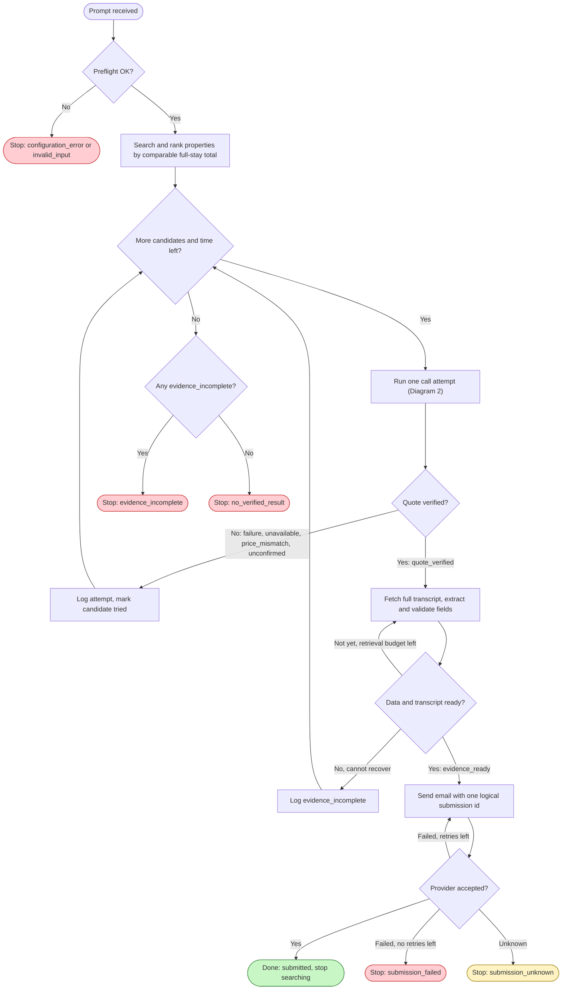
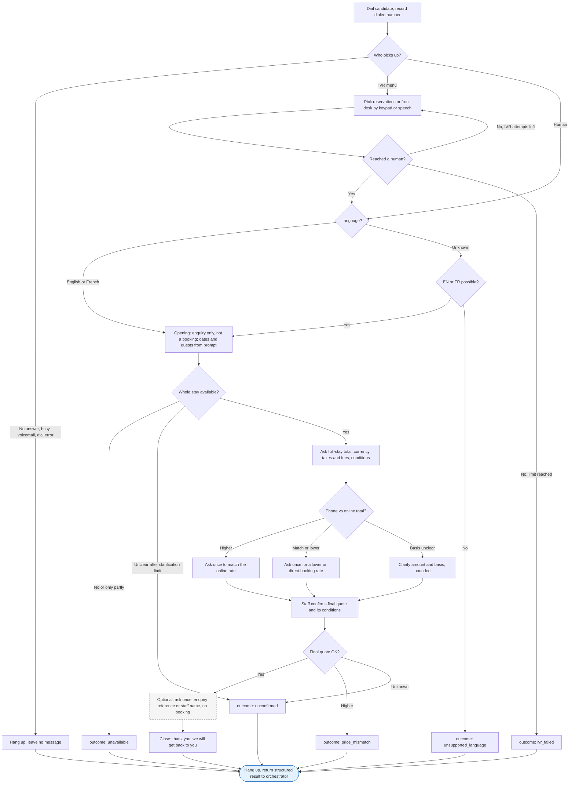

# Hotel Call Flow — Team SprintMasters (v0.2)

> How our agent phones a property and turns the call into a valid submission. Owner: Design.
> Baseline: `agent-spec.md` (team repo, current version). v0.1 was reviewed against the repair brief (F01–F18); see §13.
>
> **The call is an enquiry, not a booking.** We confirm availability and a price, optionally ask for a reference, and email the proof. We **never book, never hold a room, never pay**.
>
> **Status:** the document logic is fixed and has been walked through on paper (§14). **Nothing has been integration-tested yet:** telephony, DTMF, transcript retrieval and email sending are all still unverified (§12).

---

## 1. What "success" means

Three different things are easy to mix up, so they get separate names:

| State | Meaning | Is NOT |
|---|---|---|
| `quote_verified` | Staff confirmed the whole stay is available for our guests, and the final quote is comparable and **match-or-lower** vs. online | A booking |
| `evidence_ready` | The full, real transcript of **that** call and all required email fields are present and consistent | Sent |
| `submitted` | The email provider **accepted** the message | Read by the organizers |

```text
quote_verified =
    availability_for_requested_stay == confirmed          (unknown ≠ confirmed)
    AND guest / stay requirements from the prompt are met
    AND final quote was explicitly confirmed by staff     (us reading a number aloud ≠ confirmation)
    AND comparison_status == comparable_match_or_lower
    AND this flow did not create a booking or hold

submission_ready =
    quote_verified
    AND property_name, address, dialed_phone present
    AND full actual transcript of the selected attempt available
    AND every field comes from the selected attempt (no mixing calls)
    AND email config present (recipient, team number, template)
```

**Not required for success:** reservation #, quote reference, staff name (all Optional; F03).

**Hard rules, every state, every branch:**
- Never book, never accept a hold, never say "book it / reserve it / go ahead / hold it for me".
- Never give card or payment details. "No card needed" does **not** make booking OK.
- Never invent a number, name, price, date or transcript line. Unknown stays unknown.

---

## 2. Diagram 1: Run (orchestrator)

The orchestrator owns the queue, budgets, the quote verdict, the evidence check and the email (F12).



Decision details: `Preflight OK?` = prompt parsed (city, dates, guests) and email config present; `More candidates and time left?` = untried candidate AND run budget left; `Quote verified?` = availability and final quote verified (§1); `Data and transcript ready?` = `submission_ready` (§1).

**Every loop is bounded** (F04, F05):
- `More`: each candidate is tried at most `retry_same_number + 1` times and is marked as tried. `candidate_limit` and the run budget cap the queue.
- `Evid` loop: capped by `transcript_retrieval_budget`.
- `Send` loop: capped by `email_retry_max`. It reuses the same verified result and **never re-calls the hotel** (T26).
- **Run deadline**, at any point: start no new work, end the live call if possible, keep the records → `timed_out`. An email that was already sent keeps its own status (`submission_unknown` if unclear); it is never assumed to be un-sent (T18, T28).

**Stop policy (F18, MVP):** sequential calls, cheapest first; the **first** submission-ready result is sent and the run stops. This picks the best *verified* result among our candidates. It does **not** prove the cheapest in the whole market.

---

## 3. Diagram 2: One call attempt (voice agent + telephony)

Decision details: `Who` uses the ring budget; `EN or FR possible?` is a single check; `Whole stay available?` means every night for the prompt's guests; `Phone vs online total?` compares on the same basis (§7); `Final quote OK?` = staff-confirmed and match-or-lower.

The voice agent ends the call and **returns a structured result**. It never decides on its own that the task is done (F12).



- Interruptions such as hold, transfer, card request, booking offer, language switch, bad line or disconnect can happen **at any step**. They are handled by the **global event rules in §5**, not by fixed boxes.
- Every outcome box is a labelled result, not just a colour. The dashed `Ref` box is optional; skipping it or getting a "no" never blocks success.

---

## 4. Happy path (with Required / Optional)

| # | Step | Agent goal | Required to capture | Optional |
|---|---|---|---|---|
| 1 | Dial | Call the selected candidate | `dialed_phone`, `attempt_id`, `call_id` | — |
| 2 | Opening | One sentence: enquiry only; `check_in`, `check_out`, `guests` from the prompt | Who answered, language | — |
| 3 | Availability | Whole stay (every night) for these guests | `availability_status` (confirmed / unavailable / unknown), room or bed type | — |
| 4 | Quote | Full-stay total, currency, taxes/fees, conditions | `final_amount`, `currency`, `basis`, `tax_fee_status`, `conditions` | Nightly breakdown |
| 5 | Lower rate | Ask **once** to match (if higher) or for a lower rate (if already OK) | The final confirmed quote (⚡ a conditional "if you book now" price counts; we still don't book) | — |
| 6 | Reference | Ask **once** for an enquiry reference or staff name, without booking | — | `enquiry_reference` + `reference_type`, `staff_name` |
| 7 | Close | "Thank you, we'll get back to you." Hang up | — | — |
| 8 | Evidence | Fetch the **full transcript** of this call; extract and validate | `transcript`, all email fields | — |
| 9 | Email | Send in the current template | `submission_status`, `provider_message_id` | — |

Turns can be merged to save time. If staff give everything in one answer, don't re-ask.

### Script lines (EN / FR)

`{team_identity}`, dates and guests come from config and the prompt. Never hard-code them.

| Moment | English | Français |
|---|---|---|
| Opening | "Hi, this is {team_identity}. I'm checking availability and rates, just an enquiry, not a booking. Do you have a room for {guests} guest(s), checking in {check_in}, checking out {check_out}?" | « Bonjour, ici {team_identity}. Je vérifie la disponibilité et les tarifs, c'est seulement une demande d'information, pas une réservation. Avez-vous une chambre pour {guests} personne(s), arrivée le {check_in}, départ le {check_out} ? » |
| Quote | "What's the total for the whole stay, including taxes and fees?" | « Quel est le total pour tout le séjour, taxes et frais compris ? » |
| Match | "We saw {online_total} online for the same stay. Can you match that?" | « Nous avons vu {online_total} en ligne pour le même séjour. Pouvez-vous offrir le même prix ? » |
| Lower | "Is there any lower or direct-booking rate?" | « Avez-vous un tarif plus bas ou un tarif pour réservation directe ? » |
| Reference | "Is there a quote reference I can mention when I follow up, without making a reservation?" | « Avez-vous un numéro de référence pour ce tarif, sans faire de réservation ? » |
| Card asked | "I'm only checking rates today, so no card for now. Could you still confirm the total?" | « Je vérifie seulement les tarifs aujourd'hui, donc pas de carte pour l'instant. Pouvez-vous quand même confirmer le total ? » |
| Offer to book | "Please don't book it. I'll get back to you." | « Ne réservez pas, s'il vous plaît. Je vous rappelle. » |
| Close | "Thank you, we'll get back to you." | « Merci, nous vous rappellerons. » |

---

## 5. Global event rules (any step of the call)

| Event | Do now | Then |
|---|---|---|
| **Hold / "please wait"** | Stay silent and keep the line open | Human returns → resume the **first unconfirmed** step. `hold_timeout` → `hold_timeout`. Re-entering hold does **not** reset the call or run budget |
| **Transfer / IVR again** | Keep all confirmed fields; run the bounded IVR loop | On pickup, check it's still the same property, then resume |
| **Card / payment request** | Decline politely (script) | Can still get the quote → resume. Payment required to confirm anything → `payment_required` |
| **Offer to book or hold** ("I'll book it now, no card needed") | Refuse: "Please don't book it" | Continue the enquiry. If a reference only comes *with* a booking → give up the reference; the quote still stands (T07, T21) |
| **Staff say a booking was already made** | Clarify and ask them to cancel it; record it as an anomaly | Never report it as a normal enquiry success, never claim it was cancelled without proof |
| **Language switch** | Switch EN↔FR, keep all fields | Unknown language → one check (Diagram 2) → `unsupported_language` |
| **Bad line / unclear answer** | Ask to repeat, then read back once (`clarification_limit`) | Still unclear → `unconfirmed` or `line_failure` |
| **New staff corrects the price** | The **latest explicit** quote for this stay wins; keep both in the log | Re-run the comparison |
| **Disconnected** | Save what we have | Key confirmations + transcript complete → evaluate normally (a missing "goodbye" is fine). Otherwise → `line_failure` |
| **Asked for name / contact** | Give the configured `team_identity` / `approved_contact` only | Not configured → "This is an enquiry only." Can't continue without it → `info_required` |
| **Asked "are you a bot?"** | Answer truthfully using the configured introduction | Continue |
| **Telephony / runtime error** | Log the error and the budget used | `provider_error` → bounded retry or next candidate; never shown as success |
| **Run deadline / cancel** | Stop new work, end the call if possible, keep the records | `timed_out` / `cancelled`; email status kept separately |

---

## 6. Edge cases → outcome

| Situation | Agent behaviour | Outcome / fallback |
|---|---|---|
| IVR menu | Keypad (DTMF) or say "reservations" / "operator"; bounded by `ivr_attempt_limit` | Human → continue; limit hit → `ivr_failed` → next |
| Hold music | Silent, keep the line | `hold_timeout` → next |
| No answer / busy / voicemail | Hang up, no message | `no_answer` / `voicemail` → next |
| Fully booked, or only some nights free | Thank them, close | `unavailable` → next |
| "Maybe" / "ask the manager" / "call back tomorrow" | One clarification | `unconfirmed` → next. Never treated as available |
| Final quote higher, no match | Asked once to match, once for a lower rate | `price_mismatch` → next (AS §5) |
| Higher at first, then matched or discounted | Re-check the **final** quote | Can succeed (T03) |
| Lower only "if you book now" | Record the price + the condition; "I'll get back to you" | Counts as our quote (⚡ AS §6); no booking |
| Price basis unclear (per night vs stay, tax, currency, per bed vs room) | Clarify; normalise only from the staff's actual numbers | Still not comparable → `unconfirmed` → next |
| Member-only rate | Record it as conditional, eligibility unknown | Not comparable unless a public rate is also confirmed |
| Wrong property / same name, different address | Don't mix data | `wrong_property` → next |
| Card requested | Decline | Continue, or `payment_required` |
| French / unknown language | Switch / one check | Continue, or `unsupported_language` |
| Bad line | Repeat → read back, `clarification_limit` | `line_failure` / `unconfirmed` |

---

## 7. Price rules (F08)

1. Compare **full-stay totals** on the **same basis**: same currency, number of nights, guests and unit (room vs bed), and tax status.
2. Per-night phone quote → × nights, plus **confirmed** fees. Never guess tax rates, FX rates or fees.
3. Tax unknown = `unknown`, **not 0**.
4. Preferred question: "full-stay total including known mandatory taxes and fees". If staff confirm that number, don't ask for a breakdown.
5. A pre-tax vs pre-tax comparison is allowed only if `price_comparison_basis` permits it (team decision, §11); then label it "pre-tax", never "total incl. tax".
6. Verdict: `comparable_match_or_lower` | `comparable_higher` | `not_comparable_or_unknown`. The third one is **not** success, and it is not "they refused to match".
7. Our own reading of the online price is **not** confirmation. Staff must state or clearly agree to the number (T04).

| Example (test data, not real quotes) | Result |
|---|---|
| Online $100, phone $140 final, same basis | `price_mismatch` |
| Online $100, phone $140 → matched to $100 | OK |
| Online $100, phone $85 "if you book now" | OK: record $85 + the condition; don't book |
| Online stay total $220; phone $100/night × 2 + $30 confirmed fees | Phone total = $230 → `price_mismatch` |
| Online incl. tax, phone excl. tax, tax unknown | `not_comparable_or_unknown` → clarify → else next |
| "Around 100", won't confirm | `unconfirmed` |

---

## 8. Who does what (F12)

| Component | Owns |
|---|---|
| **Voice agent** (ElevenLabs) | Conversation, language, IVR/hold behaviour, availability and quote questions, optional reference, refusing booking and payment. Returns a structured result |
| **Telephony integration** | Dialing, call status, DTMF execution, hang-up, `call_id`, transcript retrieval |
| **Orchestrator** | Preflight, candidate queue, budgets, quote verdict, evidence check, email, terminal states |
| **UI / metrics** | Shows the **real** states (§10), live transcript, time, tokens, cost, final email |

One process may play several roles. This split is about responsibility, not deployment.

---

## 9. Result data contract (per attempt)

| Group | Fields | Rule |
|---|---|---|
| Links | `run_id`, `attempt_id`, `candidate_id`, `call_id` | `call_id` may be empty if no call was created |
| Property | `property_name`, `address`, `dialed_phone` | `dialed_phone` = the number actually dialed |
| Stay | `check_in`, `check_out` (departure day), `nights`, `guests` | From the prompt; defaults only per §11 |
| Availability | `availability_status`, `room_or_bed_type`, `requirements_met` | confirmed / unavailable / unknown |
| Online baseline | `online_quote_raw`, `online_amount`, `currency`, `basis`, `source`, `observed_at` | Source kept |
| Phone quote | `quoted_amount_raw`, `final_amount`, `currency`, `basis`, `tax_fee_status`, `conditions`, `quote_history[]` | Units always explicit |
| Comparison | `comparison_status`, `comparison_reason` | Three values (§7) |
| Optional | `enquiry_reference`, `reference_type`, `staff_name` | May be empty; never fabricated; never a system ID |
| Call | `outcome`, `failure_reason`, `language`, `ivr_seen`, `hold_seconds` | Success and failure both logged |
| Evidence | `transcript`, `transcript_status`, `evidence_source` | Real full transcript; `[inaudible]` kept as is |
| Submission | `submission_status`, `logical_submission_id`, `provider_message_id` | One logical id per run |
| Metrics | `started_at`, `ended_at`, `elapsed_ms`, `tokens`, `estimated_cost` | Observed values only; otherwise `unknown` |

---

## 10. State vocabulary

| Layer | Values |
|---|---|
| Business | `verified` · `unavailable` · `price_mismatch` · `unconfirmed` |
| Call failure | `no_answer` · `voicemail` · `ivr_failed` · `hold_timeout` · `call_timeout` · `line_failure` · `payment_required` · `info_required` · `unsupported_language` · `wrong_property` · `provider_error` |
| Evidence | `pending` · `complete` · `incomplete` · `retrieval_failed` |
| Submission | `not_ready` · `ready` · `sending` · `accepted` · `failed` · `unknown` |
| Run terminal | `submitted` · `no_verified_result` · `evidence_incomplete` · `submission_failed` · `submission_unknown` · `configuration_error` · `invalid_input` · `timed_out` · `cancelled` |

The UI must never show "Booked" or "Reservation confirmed" as a state. The organizer-mandated email **subject** says "Reservation Confirmed!"; that is template text, not our state.

---

## 11. Config & defaults

**Suggested default = a starting value to tune in testing. These are not organizer rules.**

| Key | Value | Status |
|---|---|---|
| `submission_email` | — | **Required, still TBA** (Notion). Missing → `configuration_error` |
| `team_number` | 20 | Set (team check-in; already in agent-spec) |
| `email_template_version` | Notion, checked 10:50 | **Re-check at ~17:00** |
| `team_identity` / `approved_contact` | — | **Team decision before run.** Never invented |
| `guests_default` | 1, only if the prompt gives no number | Suggested default; never overrides the prompt |
| `ring_timeout_s` | 25 | Suggested default |
| `ivr_attempt_limit` | 3 | Suggested default |
| `hold_timeout_s` | 90 | Suggested default (from v0.1) |
| `call_budget_s` | 240 | Suggested default; does not reset on hold or transfer |
| `run_budget_s` | 1200 (20 min) | Suggested default; fits the 17:15–17:45 window and includes evidence + email time |
| `clarification_limit` | 2 | Suggested default |
| `candidate_limit` | 5 | Suggested default |
| `retry_same_number` | 0 | Suggested default |
| `research_extra_candidates` | off (if on: max 1 extra search) | Suggested default |
| `transcript_retrieval_budget_s` | 30 | Suggested default |
| `email_retry_max` | 2, same `logical_submission_id` | Suggested default |
| `price_comparison_basis` | full-stay total incl. known mandatory taxes/fees; pre-tax vs pre-tax only if both sides are clearly pre-tax | **Team decision** |
| `call_concurrency` | sequential | Suggested default (§2 stop policy) |

---

## 12. Open questions

| # | Question | Type | Current answer |
|---|---|---|---|
| 1 | Hold / call / run time limits | Suggested default | §11 values; tune in testing |
| 2 | Taxes and fees | Team decision | Ask for the full-stay total incl. known fees; unknown ≠ 0 (§7) |
| 3 | Name / contact the agent gives | Team decision | Configure `team_identity` before the run; nothing invented |
| 4 | Can our telephony send **DTMF** keypresses? | **Integration check** | Unverified. Fallback: say "reservations" / "operator" → `ivr_failed` |
| 5 | Sequential vs parallel calls | Suggested default | Sequential for MVP. Parallel needs winner selection, duplicate-send guard, ending the losing calls and a shared budget |
| 6 | Can we get the **full transcript** of each call quickly after hang-up? | **Integration check** | Unverified; bounded by `transcript_retrieval_budget_s` |
| 7 | Hold/turn detection, transfer recovery, French speech | **Integration check** | Unverified |
| 8 | Email provider: idempotency / status lookup? | **Integration check** | Unknown; we don't promise exactly-once delivery |
| 9 | Recipient address | Organizer | TBA |
| 10 | **Spec clarification needed:** AS §6 says "get a reservation / hold number" but also "never book" | Interpretation | We read it as **enquiry-only**: we accept a reference only if no booking or hold is created |
| 11 | **Spec clarification needed:** the subject says "Reservation Confirmed!" but nothing is booked | Interpretation | Keep the mandated subject; the body and our states say "quote verified" |

---

## 13. Change log v0.1 → v0.2 (F01–F18)

| ID | Fix | Where |
|---|---|---|
| F01 | The final quote is re-checked; higher → `price_mismatch` → next; unknown ≠ match | Diagram 2 `FinalOk`; Diagram 1 `Eval`; §7 |
| F02 | Enquiry-only wording; reference only without booking; refuse "book it" anywhere | §1 hard rules; Diagram 2 `Open`, `Ref`; §4 scripts; §5 |
| F03 | Reference and staff name moved to Optional; never block success | §1; §4 table; dashed `Ref` |
| F04 | Queue-exhausted terminals; candidates marked tried; capped retries | Diagram 1 `More`, `AnyInc`; §11 |
| F05 | Ring/IVR/hold/call/run budgets; hold doesn't reset them; deadline behaviour | §2 notes; §5; §11 |
| F06 | Evidence step split out; validation before sending | Diagram 1 `Evid`, `Ready`; §1 `submission_ready` |
| F07 | Uses the prompt's check-in, check-out and guests; default only if missing | Diagram 2 `Open`; §4; §11 `guests_default` |
| F08 | Same-basis full-stay comparison; three-value verdict | §7 |
| F09 | Whole stay + guests; partial / maybe = not available; `wrong_property` | Diagram 2 `Avail`; §6 |
| F10 | Interruptions are global events with resume points | §5 |
| F11 | `quote_verified` / `evidence_ready` / `submitted` / failure states kept separate | §1; §10 |
| F12 | Voice agent returns a result; the orchestrator owns queue, verdict, email | Diagram 1 vs 2; §8 |
| F13 | Preflight config check; bounded email retry; one logical id; unknown status | Diagram 1 `Pre`, `Send`, `Sent`; §11 |
| F14 | DTMF, transcript and language marked "needs integration check" | §12 #4, #6, #7 |
| F15 | Configured identity; `unknown` language exit; `info_required` | Diagram 2 `LangQ`; §5 |
| F16 | Per-attempt ids; every outcome logged; evidence tied to the selected attempt | §9; Diagram 1 `Log` |
| F17 | Diagrams, tables, scripts and questions aligned; 90 s is a config value | Whole doc |
| F18 | Sequential, first verified result wins, no "cheapest in market" claim | §2 stop policy; §11; §12 #5 |

---

## 14. Scenario walkthrough (paper check only)

✅ = the document produces the expected result. All are **paper checks**; none are integration-tested.

| ID | Path through the document | ✅ |
|---|---|---|
| T01 | Human EN → Avail yes → match → `Ref` → `Ret` → `Eval` yes → `Ready` → `Send` → `submitted`, one id | ✅ |
| T02 | `Cmp` higher → `MatchAsk` → `Final` $140 → `FinalOk` higher → `price_mismatch` → `Log` → next | ✅ |
| T03 | `Cmp` higher → match to $100 → `FinalOk` yes | ✅ |
| T04 | §7 rule 7: our read-back ≠ confirmation → `Clarify` → `unconfirmed` if staff don't confirm | ✅ |
| T05 | §6 "if you book now" → record $85 + condition, no booking | ✅ |
| T06 | `Ref` is optional; §1 lists no reference/name requirement | ✅ |
| T07 | §5 booking offer: give up the reference, quote stands | ✅ |
| T08 | §5 card request: decline → resume the first unconfirmed step | ✅ |
| T09 | §5: payment needed to confirm → `payment_required` → no submit | ✅ |
| T10 | §7 rule 2: $/night × nights + confirmed fees vs online stay total | ✅ |
| T11 | §7 rules 3, 5, 6 → `not_comparable_or_unknown` unless the basis is recoverable and policy allows → next | ✅ |
| T12 | §7 rule 1: no FX guessing → clarify → `unconfirmed` → next | ✅ |
| T13 | "Around 100" → `unconfirmed` (§7 table) | ✅ |
| T14 | `IVRok` limit → `ivr_failed` → `Ret` → next | ✅ |
| T15 | §5 hold/transfer: fields kept, budgets not reset | ✅ |
| T16 | `Fail1` → logged outcome → `More`; voicemail gets no message | ✅ |
| T17 | `More` no → `AnyInc` no → `no_verified_result`; tried candidates not re-dialed | ✅ |
| T18 | `call_budget_s` → `call_timeout` → next; run deadline → `timed_out`, email status kept | ✅ |
| T19 | `Avail` "only partly" → `unavailable` → next | ✅ |
| T20 | §5 language switch + transfer: fields kept, task not restarted | ✅ |
| T21 | §5 offer to book: refuse; no card ≠ permission | ✅ |
| T22 | §5 disconnect: complete evidence → evaluate; before the quote → `line_failure` | ✅ |
| T23 | `Ready` "not yet" loop, bounded; no summary instead of the transcript | ✅ |
| T24 | §1 `submission_ready`: evidence from the selected attempt only → block | ✅ |
| T25 | Re-extract from the transcript; drop invented fields (§1 hard rules) | ✅ |
| T26 | `Send` retry reuses the result; never re-calls | ✅ |
| T27 | One `logical_submission_id` per run; duplicate callbacks ignored | ✅ (real dedup depends on provider, §12 #8) |
| T28 | `Sent` unknown → `submission_unknown`, no blind resend | ✅ |
| T29 | `Open` uses `{guests}` from the prompt; default only if missing | ✅ |
| T30 | `Pre` no → `invalid_input`; no extra user question | ✅ |
| T31 | Search is "properties", any type; bed vs room basis per §7 | ✅ |
| T32 | §6 `wrong_property` → next, no data mixing | ✅ |
| T33 | `Pre` → `configuration_error`; no "TBA"/"X" sent | ✅ |
| T34 | §12 #4 unverified; fallback speech/operator → `ivr_failed` | ✅ |
| T35 | §5 name/contact: configured only → `info_required`; `LangQ` → `unsupported_language` | ✅ |
| T36 | §9 per-attempt logs; failed calls don't need transcripts | ✅ |
| T37 | §2 stop policy; no market-wide claim | ✅ |

**Not covered by this walkthrough (needs real testing):** DTMF on our telephony, hold detection, French voice quality, transcript latency and completeness, email provider behaviour, real timing against the suggested budgets.
